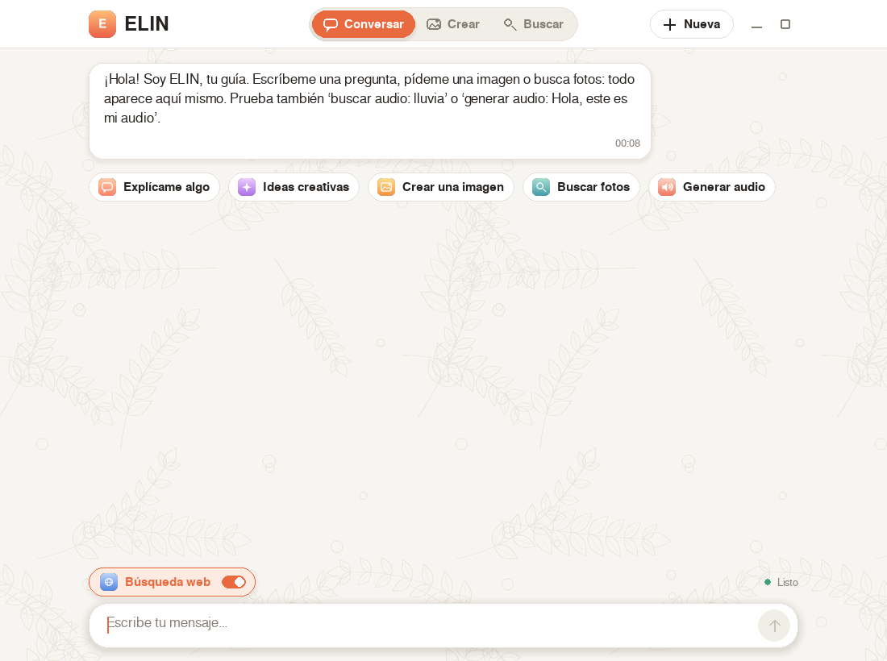

# ELIN

Aplicación de escritorio en **Python + Pygame** con un entorno limpio y centrado para
conversar, **crear imágenes**, **buscar imágenes en internet** y **generar/buscar audio**.
Cada imagen indica dónde se creó o se buscó y si usó aprendizaje automático o solo Python.



## Características

- Interfaz compacta y centrada: barra superior con selector de modo (Conversar · Crear · Buscar),
  menús desplegables para motor, estilo, formato y fuentes, y un cuadro de texto de una sola línea que crece al escribir.
- Presentación inicial con barra de carga.
- Sugerencias de inicio y descripciones emergentes (tooltips) en los botones de solo icono.
- Minimizar / maximizar (también con `F11`).
- Chat con respuestas de IA (Pollinations, o un modelo local con Ollama).
- Creación de imágenes con varios proveedores y respaldo automático:
  Pollinations (Flux / Turbo), Stable Horde, Hugging Face, IA local (PyTorch + diffusers)
  y arte generativo con Pillow (funciona sin internet).
- Búsqueda de imágenes: DuckDuckGo, Openverse, Wikimedia, y opcionalmente Pexels, Unsplash y Google CSE.
- Las imágenes aparecen dentro de la conversación y se abren en grande al pulsarlas.
- Conversión de texto a audio (MP3) con gTTS.

## Requisitos

- Python 3.10 o superior
- Windows, macOS o Linux

## Instalación

```bash
git clone https://github.com/<tu-usuario>/elin.git
cd elin

python -m venv venv
# Windows:  venv\Scripts\activate
# macOS/Linux:  source venv/bin/activate

pip install -r requirements.txt
```

Para usar IA de imágenes **local** (opcional, pesado):

```bash
pip install -r requirements-local.txt
```

## Uso

```bash
python elin.py
```

### Atajos de teclado

| Tecla | Acción |
|---|---|
| `Enter` | Enviar mensaje |
| `Shift + Enter` | Nueva línea |
| `Ctrl + Enter` | Crear imagen rápidamente |
| `Ctrl + N` | Nueva conversación |
| `Ctrl + V` | Pegar |
| `F11` | Maximizar / restaurar |
| `Esc` | Cerrar imagen ampliada / limpiar texto |
| `RePág / AvPág` | Desplazar la conversación |

### Comandos del chat

```
buscar audio: término
generar audio: texto para convertirlo en MP3
```

## Configuración (opcional)

ELIN funciona sin claves. Para ampliar proveedores, define variables de entorno
(ver [`.env.example`](.env.example)):

| Variable | Para qué sirve |
|---|---|
| `POLLINATIONS_API_KEY` | Acceso autenticado a Pollinations |
| `HF_TOKEN` | Activa Hugging Face (FLUX) |
| `HORDE_API_KEY` | Prioridad en Stable Horde |
| `PEXELS_API_KEY` | Búsqueda en Pexels |
| `UNSPLASH_ACCESS_KEY` | Búsqueda en Unsplash |
| `GOOGLE_CSE_API_KEY` y `GOOGLE_CSE_ID` | Búsqueda con Google Custom Search |
| `ELIN_HF_MODEL`, `ELIN_LOCAL_MODEL` | Cambiar modelo de Hugging Face / local |
| `ELIN_OLLAMA_URL`, `ELIN_OLLAMA_MODEL` | Chat con Ollama local |
| `ELIN_FORCE_LOCAL=1` | Forzar generación local |

Ejemplo en Windows (PowerShell): `$env:HF_TOKEN="tu_token"; python elin.py`
Ejemplo en macOS/Linux: `HF_TOKEN=tu_token python elin.py`

## Estructura del proyecto

```
elin/
├── elin.py                 # aplicación principal
├── requirements.txt        # dependencias básicas
├── requirements-local.txt  # dependencias opcionales (IA local)
├── .env.example            # plantilla de variables de entorno
├── assets/                 # iconos PNG opcionales para los botones
├── docs/                   # capturas para el README
├── imagenes_elin/          # imágenes guardadas (se crea sola, no se sube)
└── audios_elin/            # audios guardados (se crea sola, no se sube)
```

## Privacidad

Los textos que escribes se envían a los servicios en línea que elijas (Pollinations,
Hugging Face, Stable Horde, buscadores, gTTS). No escribas información sensible.
Con Ollama y la IA local, el procesamiento ocurre en tu equipo.

## Contribuir

Consulta [CONTRIBUTING.md](CONTRIBUTING.md).

## Licencia

[MIT](LICENSE)
